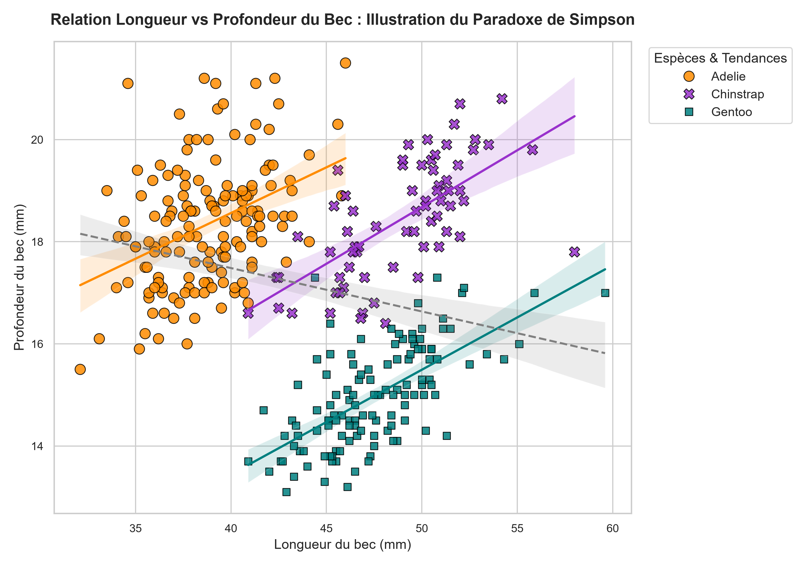
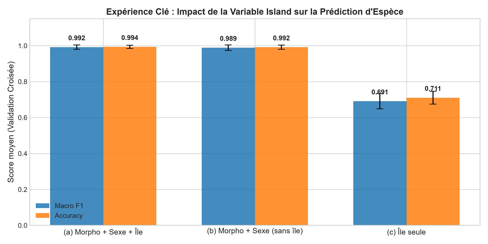
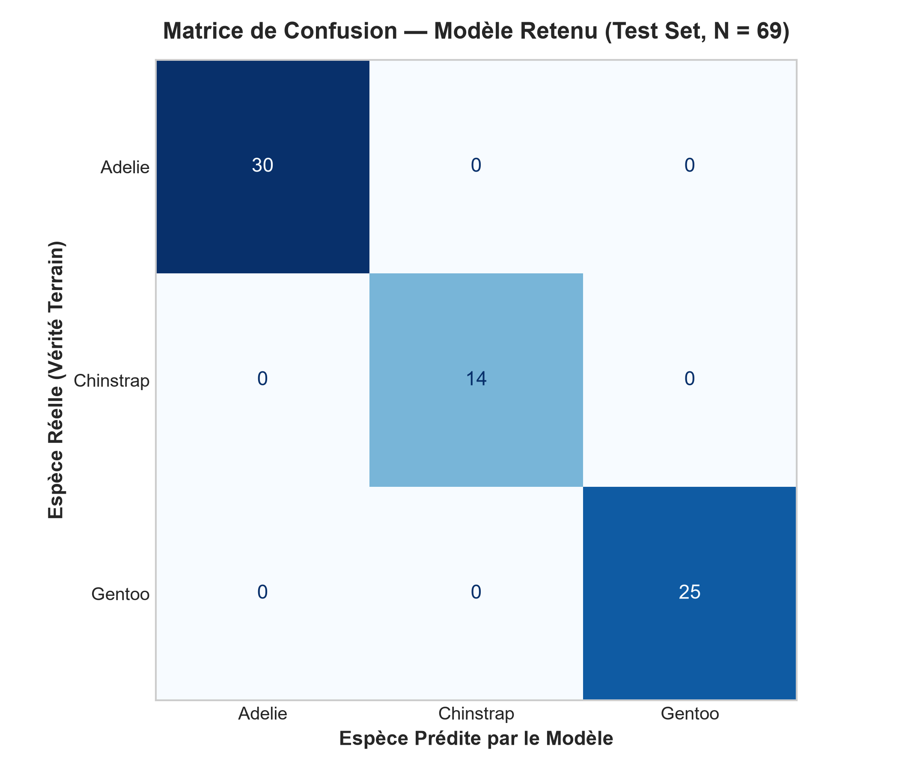
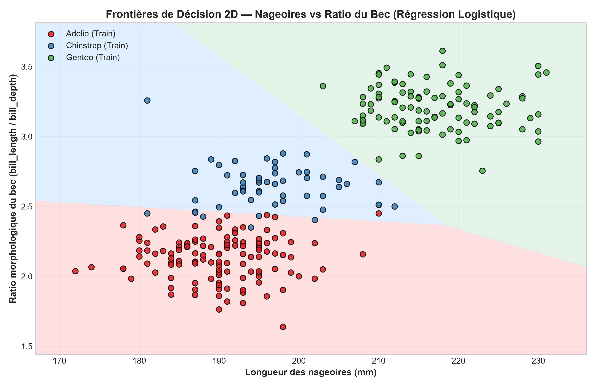

# 🐧 Palmer Penguins — Exploratory Data Analysis & Species Classification
> **End-to-End Data Science & Machine Learning Portfolio Project**  
> **Author:** Assia Farah ([@farah-assia](https://github.com/farah-assia))  
> **Tools:** Python 3 · Scikit-learn · Pandas · NumPy · Matplotlib · Seaborn · Jupyter / Google Colab · ReportLab  
> **Dataset:** Palmer Penguins (*Palmer Station LTER, Antarctica* — CC0)  
> **License:** MIT License  

---

[](https://colab.research.google.com/github/farah-assia/palmer-penguins-eda/blob/main/01_data_exploration.ipynb)
[](https://colab.research.google.com/github/farah-assia/palmer-penguins-eda/blob/main/02_classification.ipynb)
[](LICENSE)

---

## 🌍 Executive Summary & Project Framing

This repository presents an end-to-end data science study of the **Palmer Penguins** dataset collected by Dr. Kristen Gorman and the Palmer Station Long Term Ecological Research (LTER) program in the Palmer Archipelago, Antarctica.

> ℹ️ **Project Context:**  
> The framing ("Client Mission N° 01") is a **fictional educational simulation** modeled after an applied consulting mission for an ecological research institute. It covers both:
> 1. **Phase 1 — Exploratory Data Analysis (EDA):** Morphological diversity audit, descriptive statistics, outlier diagnosis, and data leakage checks.
> 2. **Phase 2 — Predictive Species Classification:** Feature engineering, k-NN sex imputation inside Scikit-learn pipelines, hyperparameter optimization, the 3-configurations experiment on geographic confounding (`island`), and rigorous statistical evaluation.

---

## 🌟 Key Highlights & Discoveries

* **Rigorous Data Cleaning & Integrity:**  
  * Raw dataset: **344 records** across 3 species (*Adelie*: 152, *Gentoo*: 124, *Chinstrap*: 68).
  * Only **2 records without any physical measurements** were removed (index 3: Adelie on Torgersen; index 339: Gentoo on Biscoe), yielding **$N = 342$ valid morphological individuals** (*Adelie*: 151, *Gentoo*: 123, *Chinstrap*: 68).
  * Missing `sex` values: **11 in the raw dataset, exactly 9 in the cleaned dataset** (all 9 had complete physical measurements and were preserved during EDA, then cleanly imputed via $k$-NN within the machine learning pipeline).
* **Biological Reality vs. Statistical Outliers:**  
  Tukey's IQR rule ($1.5 \times \text{IQR}$) flagged several penguins as body mass outliers. However, domain investigation proved that these individuals belong exclusively to the **Gentoo** species, which is naturally **$\approx 37\%$ heavier** ($\mu = 5076\text{ g}$ vs. $\mu \approx 3701\text{ g}$ for Adelie). These points reflect genuine evolutionary allometry and were deliberately retained.
* **Simpson's Paradox Revealed:**  
  A naive aggregate correlation suggests a negative relationship between culmen length and depth ($r = -0.24$). Once stratified by species, the correlation **reverses and becomes strongly positive** across all three species (*Gentoo*: $r = +0.64$; *Chinstrap*: $r = +0.65$; *Adelie*: $r = +0.39$).
* **Gentoo Bivariate Isolation Rule:**  
  A simple heuristic (`flipper_length_mm >= 205` **AND** `body_mass_g >= 4400`) isolates *Gentoo* with **97.39% precision** and **91.06% recall** (112 true positives out of 123 total Gentoo penguins).
* **Top Engineered Feature (`bill_ratio`):**  
  The morphological ratio $\text{bill\_ratio} = \frac{\text{bill\_length\_mm}}{\text{bill\_depth\_mm}}$ emerged as the **#1 most important feature** ($\approx 36.4\%$ relative importance in Random Forest), capturing beak geometry independently of overall bird scale.
* **The `island` Confounder Experiment:**  
  * Config (c) with `island` alone achieves **$71.07\%$ accuracy** without examining the penguin, because Gentoo is endemic to Biscoe and Chinstrap to Dream. However, it cannot separate sympatric Adelie penguins on those islands.
  * Config (a) with `island` scored slightly higher in cross-validation ($0.9921$ vs $0.9892$ Macro F1). However, we **deliberately excluded `island` (Config b)** to prevent **shortcut learning**. Geographic origin is a spatial confounder that does not generalize to new Antarctic colonies or dispersing individuals.
* **Statistical Caution on 100% Test Accuracy:**  
  While our selected model (Logistic Regression without `island`) achieved **100% accuracy on the hold-out test set ($N = 69$)**, we explicitly note that **100% on a small sample is not proof of perfection**. The **Repeated Stratified 5-Fold Cross-Validation score ($98.92\% \pm 1.52\%$, 50 splits)** is the statistically robust estimate of real-world generalization performance.

---

## 📸 Key Visualizations

### 1. Simpson's Paradox: Culmen Length vs. Culmen Depth
The aggregate regression line (dashed gray, $r = -0.24$) conceals strong positive intraspecific correlations within all three species:



### 2. The 3 Configurations Experiment (Impact of the `island` Variable)
Comparing (a) all features, (b) morphological features without `island`, and (c) `island` as the sole predictor:



### 3. Confusion Matrix & 2D Decision Boundaries
The confusion matrix on the hold-out test set ($N=69$) and the 2D decision boundary projection on flipper length and bill ratio:

| Confusion Matrix (Hold-out Test $N=69$) | 2D Decision Boundaries (Flipper vs Bill Ratio) |
| :---: | :---: |
|  |  |

---

## 📂 Repository File Tree

```text
├── 01_data_exploration.ipynb          # Phase 1: Full exploratory data analysis & statistical audit
├── 02_classification.ipynb             # Phase 2: ML pipeline, feature engineering, CV & model evaluation
├── README.md                          # Project documentation, findings, and execution guide
├── report.pdf                         # 4-page executive PDF summary (A4 format, ReportLab)
├── requirements.txt                   # Reproducible Python dependencies (with scikit-learn >= 1.3)
├── LICENSE                            # MIT Open Source License
├── .gitignore                         # Python cache and temporary files exclusion
│
├── data/
│   └── penguins.csv                   # Raw source dataset (344 rows, CC0 Palmer Station LTER)
│
├── figures/                           # High-resolution (300 DPI) publication figures
│   ├── 01_histograms_distributions.png
│   ├── 02_boxplots_by_species.png
│   ├── 03_scatter_bill_dimensions.png
│   ├── 04_correlation_matrix.png
│   ├── 05_body_mass_by_species.png
│   ├── 06_species_by_island.png
│   ├── 07_flipper_vs_bodymass.png
│   ├── comparison_3_configurations.png # Phase 2: Bar plot comparing Configs (a), (b), and (c)
│   ├── confusion_matrix.png           # Phase 2: Hold-out test set confusion matrix
│   ├── feature_importances.png        # Phase 2: Logistic coefficients & RF feature importances
│   └── decision_boundary_2d.png       # Phase 2: 2D classification decision surface
│
└── scripts/                           # Reproducible automation scripts
    ├── generate_figures.py            # Generates Phase 1 EDA figures
    ├── build_pdf_report.py            # Compiles the 4-page PDF executive report
    ├── build_notebook.py              # Compiles and runs 01_data_exploration.ipynb end-to-end
    └── build_classification_notebook.py # Compiles and runs 02_classification.ipynb end-to-end
```

---

## 📊 Summary of Data & Descriptive Statistics

### Dataset Attributes

| Variable | Data Type | Nature | Unit | Biological Description |
| :--- | :---: | :---: | :---: | :--- |
| `species` | `category` | Categorical | - | Target species: *Adelie* ($n=152$), *Gentoo* ($n=124$), *Chinstrap* ($n=68$). |
| `island` | `category` | Categorical | - | Breeding island: *Biscoe* ($n=168$), *Dream* ($n=124$), *Torgersen* ($n=52$). |
| `bill_length_mm` | `float64` | Continuous | mm | Culmen length (dorsal ridge of the upper beak). |
| `bill_depth_mm` | `float64` | Continuous | mm | Culmen depth (vertical thickness of the bill at base). |
| `flipper_length_mm` | `float64` | Continuous | mm | Flipper length. |
| `body_mass_g` | `float64` | Continuous | g | Total body mass. |
| `sex` | `category` | Categorical | - | Sex: *Male* (168), *Female* (165), Missing (11 in raw, 9 in clean). |

### Univariate Descriptive Statistics ($N = 342$ valid records)

| Metric | Mean | Median | Mode | Std Dev ($s$) | Variance ($s^2$) | Min | Q1 | Q3 | Max | Range | IQR |
| :--- | :---: | :---: | :---: | :---: | :---: | :---: | :---: | :---: | :---: | :---: | :---: |
| **Bill Length (mm)** | 43.92 | 44.45 | 41.10 | 5.46 | 29.81 | 32.10 | 39.23 | 48.50 | 59.60 | 27.50 | 9.27 |
| **Bill Depth (mm)** | 17.15 | 17.30 | 17.00 | 1.97 | 3.90 | 13.10 | 15.60 | 18.70 | 21.50 | 8.40 | 3.10 |
| **Flipper Length (mm)**| 200.91| 197.00 | 190.00| 14.06 | 197.73 | 172.00 | 190.00 | 213.00 | 231.00 | 59.00 | 23.00 |
| **Body Mass (g)** | 4201.75| 4050.00| 3800.00| 801.95 | 643,131.07| 2700.00| 3550.00| 4750.00| 6300.00 | 3600.00| 1200.00|

---

## 🤖 Phase 2: Species Classification & Modeling

### 1. Methodology & Anti-Leakage Protocol
* **Stratified 80/20 Split:** 273 samples for training, 69 for hold-out test (`random_state=42`, stratified by `species`).
* **Strict Anti-Leakage Pipeline:** Imputation ($k$-NN, $k=5$) and scaling (`StandardScaler`) are fitted strictly on training folds inside Scikit-learn `Pipeline` objects.
* **Evaluation Metric:** **Macro F1-score** is selected over accuracy because it treats all species equally, preventing the model from ignoring the minority class (*Chinstrap*, $\approx 20\%$).
* **Validation Strategy:** **Repeated Stratified 5-Fold Cross-Validation (10 repeats = 50 folds)** to provide stable estimates despite the small sample size.

### 2. Algorithmic Benchmarking (Repeated 5x10 CV on Train Set)

| Model Family | Hyperparameters Tuned | Mean Macro F1 | 95% Confidence Interval | Mean Accuracy |
| :--- | :--- | :---: | :---: | :---: |
| **Baseline (Dummy Majority)** | `strategy='most_frequent'` (Adelie) | 0.2040 | - | 44.15 % |
| **Random Forest** | `n_estimators=100, max_depth=None` | 0.9749 ± 0.0159 | [0.9705, 0.9793] | 97.95 % |
| **SVM (RBF Kernel)** | `C=1.0, gamma='scale'` | 0.9820 ± 0.0160 | [0.9776, 0.9864] | 98.57 % |
| **$k$-Nearest Neighbors** | `n_neighbors=5, weights='distance'` | 0.9852 ± 0.0173 | [0.9804, 0.9900] | 98.83 % |
| **Logistic Regression (Selected)** | `C=10.0, solver='lbfgs', max_iter=1000` | **0.9892 ± 0.0152** | **[0.9850, 0.9934]** | **99.16 %** |

**Why Logistic Regression was chosen as the production model:**
1. **Top Performance:** Highest mean Macro F1 ($0.9892$) with the lowest variance.
2. **Interpretability:** Provides direct log-odds coefficients tied to allometric traits.
3. **Calibrated Probabilities:** The Softmax function outputs reliable posterior probabilities.
4. **Parsimony:** Minimal computational overhead and zero risk of hyperparameter overfitting.

### 3. The 3 Configurations Experiment: Why We Drop `island`

| Configuration | Feature Set | CV Macro F1 | CV Accuracy | Test Macro F1 ($N=69$) |
| :--- | :--- | :---: | :---: | :---: |
| **Config (a)** | Morphometrics + Sex + `island` | $0.9921 \pm 0.0121$ | $99.38\%$ | 1.0000 |
| **Config (b) [Selected]** | Morphometrics + Sex (**without `island`**) | **$0.9892 \pm 0.0152$** | **$99.16\%$** | **1.0000** |
| **Config (c)** | `island` as sole predictor | $0.6910 \pm 0.0427$ | $71.07\%$ | - |

* **Insight from Config (c):** Geographic origin alone predicts species with $71.07\%$ accuracy because Gentoo is endemic to Biscoe and Chinstrap to Dream. However, Adelie is sympatric across all three islands, capping the geographical shortcut at $\approx 71\%$.
* **Why Config (b) is preferred over Config (a):** While Config (a) scores marginally higher in CV ($+0.0029$), `island` is an ecological confounder. If this model were deployed on another Antarctic island or if penguins disperse, the model with `island` would fail. Config (b) relies purely on biological morphology and guarantees true generalization.

### 4. Hold-Out Test Set Evaluation ($N=69$) & Small-Sample Caveat

```text
              precision    recall  f1-score   support

      Adelie       1.00      1.00      1.00        30
   Chinstrap       1.00      1.00      1.00        14
      Gentoo       1.00      1.00      1.00        25

    accuracy                           1.00        69
   macro avg       1.00      1.00      1.00        69
weighted avg       1.00      1.00      1.00        69
```

> ⚠️ **Statistical Reality Check:**  
> A $100\%$ test accuracy on 69 samples is **not strong evidence of a perfect model**. Because $N=69$ is small, sampling variance makes misclassifications either absent or exaggerated. The **Repeated Stratified 5-Fold Cross-Validation score ($98.92\% \pm 1.52\%$)** across 50 splits is the true, trustworthy metric of generalization performance.

### 5. Cross-Validation Error Analysis
Analyzing out-of-fold predictions across the 273 training samples revealed **only 2 errors out of 273 ($0.73\%$ error rate)**:
* Both cases (indices 172 and 182) were **female Chinstraps** on Dream Island misclassified as **Adelie**.
* **Biological Cause:** Due to sexual dimorphism, female Chinstrap penguins have slightly shorter beaks ($42.4\text{ mm}$ and $40.9\text{ mm}$, `bill_ratio` $\approx 2.45$), placing them right at the morphological boundary of male Adelies.

---

## 💡 What I Learned

1. **Mindful Data Cleaning:** Never drop missing values blindly. We dropped only 2 empty rows, preserving 9 rows with missing sex because their physical measurements were completely intact and valuable.
2. **Domain Context Over Statistical Heuristics:** Tukey's $1.5 \times \text{IQR}$ rule labeled heavy penguins as outliers. Domain understanding showed that these were Gentoo penguins ($\approx +37\%$ mass difference). Business and domain context must always supervise data preprocessing.
3. **Simpson's Paradox in Action:** Observing an aggregate negative correlation ($r = -0.24$) flip to strong positive correlations ($+0.39$ to $+0.65$) within species was an eye-opening demonstration of confounding variables.
4. **Avoiding Shortcut Learning:** A feature like `island` can boost cross-validation scores while destroying real-world transferability. Responsible machine learning requires pruning shortcut features.
5. **Statistical Humility:** A 100% test score on a small dataset ($N=69$) should be treated with healthy skepticism; repeated cross-validation provides the true signal.

---

## 🔮 Next Steps & Future Directions

Having completed the classification model, the next steps for this project include:
1. **Interactive Web Application (Streamlit):** Build and deploy a real-time penguin identification dashboard where field researchers can input measurements and receive predicted species with calibrated probabilities.
2. **REST API Deployment (FastAPI & Docker):** Containerize the Scikit-learn pipeline for automated inference in remote monitoring setups.
3. **Model Explainability (SHAP):** Integrate SHAP (*SHapley Additive exPlanations*) force plots to explain individual predictions on ambiguous cases.
4. **Unsupervised Phenotype Clustering:** Apply t-SNE, UMAP, and HDBSCAN to test whether unsupervised morphological clustering naturally separates the three species without ground truth labels.
5. **External Validation:** Test the model on independent morphometric datasets from other Antarctic research stations.

---

## 🚀 Reproduction & Execution Guide

### Option 1 — In Google Colab (One-Click)
* [Run 01_data_exploration.ipynb in Google Colab](https://colab.research.google.com/github/farah-assia/palmer-penguins-eda/blob/main/01_data_exploration.ipynb)
* [Run 02_classification.ipynb in Google Colab](https://colab.research.google.com/github/farah-assia/palmer-penguins-eda/blob/main/02_classification.ipynb)

### Option 2 — Locally with Python and Git
```bash
# 1. Clone the repository
git clone https://github.com/farah-assia/palmer-penguins-eda.git
cd palmer-penguins-eda

# 2. Create and activate a virtual environment
python -m venv .venv
# On Windows:
.venv\Scripts\activate
# On macOS / Linux:
source .venv/bin/activate

# 3. Install required packages
pip install -r requirements.txt

# 4. Launch Jupyter Notebook or JupyterLab
jupyter notebook
```

### Option 3 — Automated Pipeline Execution
```bash
# Generate all Phase 1 figures
python scripts/generate_figures.py

# Compile the 4-page executive PDF report
python scripts/build_pdf_report.py

# Build and execute 01_data_exploration.ipynb end-to-end
python scripts/build_notebook.py

# Build and execute 02_classification.ipynb end-to-end
python scripts/build_classification_notebook.py
```

### Reproducibility Parameters
* **Python version:** >= 3.10 (tested on Python 3.14)
* **Random seed:** `RANDOM_STATE = 42` across all splits, models, and cross-validations.
* **Core dependencies:** `pandas>=2.0`, `numpy>=1.24`, `matplotlib>=3.7`, `seaborn>=0.12`, `scikit-learn>=1.3.0`, `scipy>=1.10.0`, `reportlab>=4.0`.

---

## 📚 Dataset Citation

> Gorman KB, Williams TD, Fraser WR (2014) *Ecological Sexual Dimorphism and Environmental Variability within a Community of Antarctic Penguins (Genus Pygoscelis)*. PLoS ONE 9(3): e90081. [https://doi.org/10.1371/journal.pone.0090081](https://doi.org/10.1371/journal.pone.0090081)

The Palmer Penguins dataset is made available under the **Creative Commons Public Domain Dedication (CC0 1.0 Universal)**.

---

## 🏷️ Suggested GitHub Topics
`data-science` · `machine-learning` · `eda` · `scikit-learn` · `classification` · `palmer-penguins` · `statistics` · `python` · `ecology`
